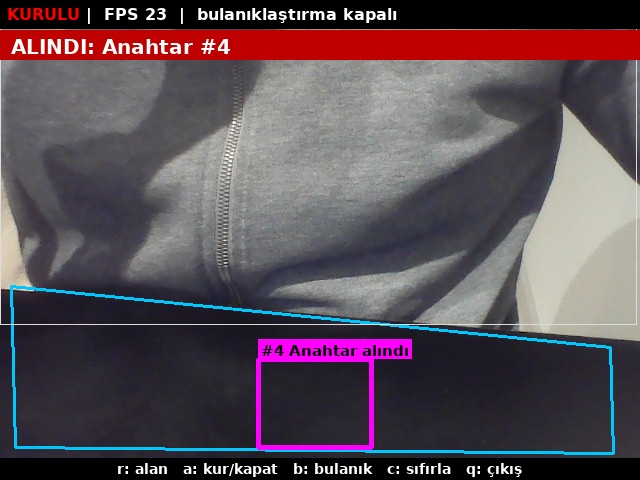
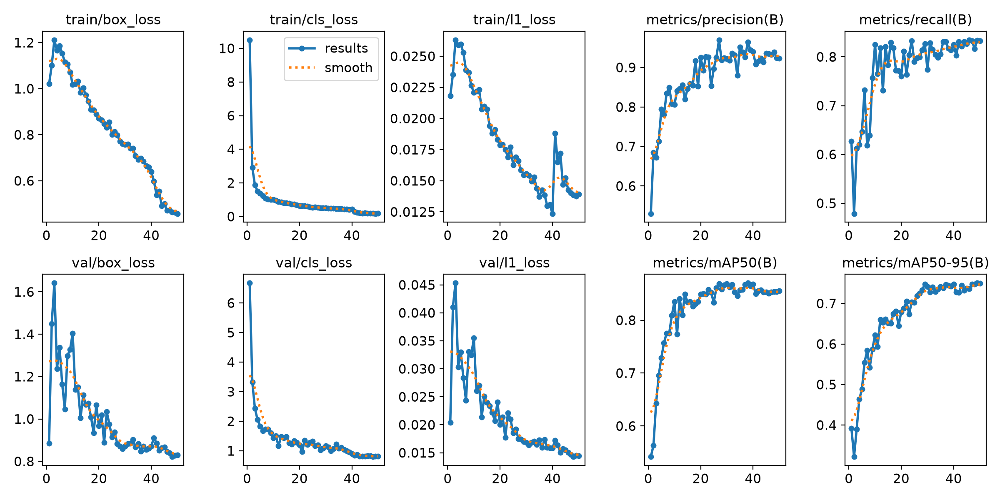
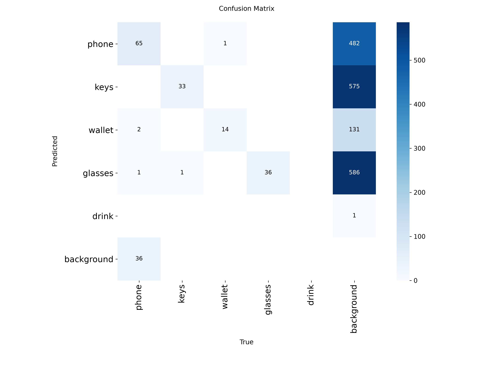

# DeskGuard



A real-time security camera for a desk or café table. DeskGuard detects personal items (phone, keys, wallet, glasses) with **YOLOE-26 / YOLO26**, tracks them with **ByteTrack**, and raises an alarm when:

- an item is **abandoned**,
- an item is **taken** while the system is armed,
- someone **reaches into the protected zone** while the system is armed.

## Features

- **Works without training.** YOLOE finds items from text prompts.
- **Decisions over time.** A state machine follows each item through the states new → stationary → abandoned / removed.
- **Fewer false alarms.**
  - A hand covering an item does not count as a theft.
  - Hands count as the owner being present.
  - Oversized boxes are rejected.
  - Each entry into the zone raises one intrusion alarm.
  - Arming has an exit delay.
- **Privacy.** Faces are blurred before anything is shown or saved.
- **Records.** Every alarm saves a snapshot and a row in `runs/alarms/events.csv`.
- **Turkish on-screen interface.**

## Setup

```bash
git clone https://github.com/<hakan-atalay>/desk-guard.git
cd desk-guard
python -m venv .venv
source .venv/bin/activate          # Windows: .venv\Scripts\activate
pip install -e .
```

Python 3.10+ is required. The first run downloads the model weights, so you need internet once.

## Usage

```bash
deskguard run                      # webcam 0
deskguard run --source 1           # second camera or phone camera
deskguard run --source demo.mp4 --record runs/demo.mp4
deskguard detect photos/           # still images -> runs/detect/ with annotated copies and JSON
```

| Key | Action |
| --- | --- |
| `r` | Draw the protected zone (left click: add point, right click: undo, Enter: confirm) |
| `a` | Arm or disarm (alarms start after a 5 s exit delay) |
| `b` | Toggle face blur |
| `c` | Reset tracked items |
| `q` | Quit |

Items, prompts and timings are defined in [`default.yaml`](src/deskguard/default.yaml). Items marked `valuable: false`, such as drinks, the menu or an ashtray, are tracked without alarms. To change them, copy the file and use `deskguard --config my.yaml run`.

## Findings on a real desk

The zero-shot YOLOE model was checked on 21 webcam photos of a real desk with a phone, keys, a slim card wallet and hands. Every photo was reviewed by hand:

| Object | In photos | Default prompts | Tuned prompts |
| --- | ---: | ---: | ---: |
| Keys | 16 | 13 | 13 |
| Phone, face down | 6 | 0 | 4 |
| Card wallet | 12 | 0 (always "phone") | 0 (always "phone") |
| Hand / arm | 6 | 4 | 4 |

Prompt tuning fixed the face-down phone but not the wallet. YOLOE has no notion of this particular card wallet, so fine-tuning on the real objects is required. This is the motivation for the training pipeline below.

## Results

The two models were compared on a test set of 21 webcam photos of a real desk. None of these photos were used for training, and their labels were corrected by hand:

- **YOLOE-26s:** zero-shot, with the tuned prompts.
- **YOLO26n:** trained on the public datasets only. No photos of the author's own items were used yet.

Hardware: RTX 3050 Laptop GPU.

| Model | FPS | mAP50 |
| --- | ---: | ---: |
| YOLOE-26s (zero-shot) | 46.9 | 0.473 |
| YOLO26n (public data) | **65.9** | **0.655** |

| Class | Photos | YOLOE AP50 / P / R | YOLO26n AP50 / P / R |
| --- | ---: | --- | --- |
| Keys | 16 | **1.00** / 1.00 / 0.88 | 0.75 / 0.89 / 0.50 |
| Phone | 15 | **0.42** / 0.50 / 0.73 | 0.39 / 0.00 / 0.00 |
| Wallet | 12 | 0.00 / 0.00 / 0.00 | **0.83** / 1.00 / 0.58 |

P and R are measured at the live confidence threshold of 0.25.

- **The trained model solves the wallet:** AP50 rises from 0.00 to 0.83, and it runs 40 % faster.
- **The trained model is weaker on the author's phone and keys.** Its phone detections all score below 0.25, so they are filtered out in live use. The public photos simply look different from this desk, so training on the author's own items is the next step.
- **Only AP50 is compared.** The test boxes were drawn by correcting YOLOE's output, which favours YOLOE's box placement, so mAP50-95 is not compared.

Training curves and the confusion matrix of the public-data model:




## Train your own model

Zero-shot YOLOE is flexible but slow and misses specific objects. DeskGuard distils it into a small, fast YOLO26n model trained on public data and on photos of your own items.

> **Status:** the public-data pipeline is complete. Training on the author's own items is the next step.

**1. Public data.** These CC BY 4.0 datasets from Roboflow Universe are downloaded, and their classes are mapped to `phone`, `keys`, `wallet`, `glasses` and `drink`:

- [Study Desk Items](https://universe.roboflow.com/yolo-object-detection-custom-dataset/study-desk-items)
- [Left-Off Objects](https://universe.roboflow.com/obj-detection-kd5zb/left-off-objects-1)
- [Lost-Found-Items](https://universe.roboflow.com/mangoesclassifierdetector/lost-found-items)

YOLOE then adds `person` and `hand` labels, which the public data lacks.

```bash
pip install -e ".[data]"
deskguard webdata --api-key YOUR_ROBOFLOW_KEY      # -> data/train
```

**2. Your own items, one item per session.** Capture each item alone. Every detected item in that session gets the given label, so no manual labelling is needed:

```bash
deskguard collect --output data/own_wallet
deskguard autolabel --images data/own_wallet --output data/train --only wallet --test-ratio 0
```

Repeat this for `phone`, `keys` and `glasses`.

**3. Train.**

```bash
yolo detect train data=data/train/data.yaml model=yolo26n.pt epochs=60 imgsz=640 batch=16 cache=ram patience=15 device=0
deskguard --weights runs/detect/train/weights/best.pt run
```

## Evaluate

Capture a separate test set, label it, and correct the labels by hand:

```bash
deskguard autolabel --images data/test_raw --output data/mytest --val-ratio 0 --test-ratio 1
```

Then compare the models:

```bash
deskguard evaluate yoloe-26s-seg.pt runs/detect/train/weights/best.pt
```

The command writes mAP50, mAP50-95, per-class AP / precision / recall and FPS to `runs/eval/metrics.md`.

## Project structure

```
src/deskguard/
├── cli.py         commands
├── config.py      settings and default.yaml loading
├── detector.py    YOLOE / YOLO26 + ByteTrack
├── monitor.py     state machine for items, owner, zone and arming
├── alarms.py      alarm messages, snapshots, CSV log
├── ui.py          Turkish overlay, face blur, zone drawing
├── app.py         live loop, image mode, image capture
└── dataset.py     public data, auto-labelling and evaluation
```

## Tests

```bash
pip install -e ".[dev]"
pytest
```

The bundled DejaVu Sans font is distributed under its own [license](src/deskguard/DejaVu-LICENSE.txt).
